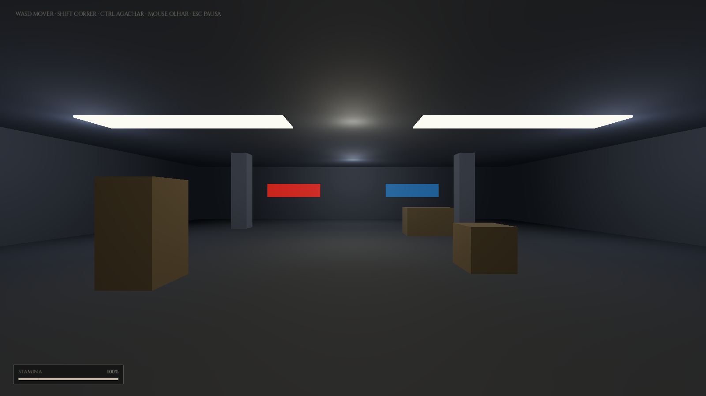

# BLACKSITE

**Black Sight** — jogo de terror cooperativo em primeira pessoa, desenvolvido em
**Godot 4.7.2**.

> **Status:** Etapa 7 concluída — **sistema genérico de interação** por olhar
> (raycast da câmera, alcance de 2,5 m, linha de visão) com a indicação
> `[E] Interagir` e um objeto de teste. Stamina, agachamento, HUD e controles
> anteriores continuam exatamente como na v0.6.2.




## Download do jogo (Windows)

**https://github.com/EtecStudy/BLACKSITE/releases/download/v0.7.0-etapa7-interaction/BlackSight-Etapa7-Interaction-Windows-x86_64.zip**

Arquivo: `BlackSight-Etapa7-Interaction-Windows-x86_64.zip` (40.653.078 bytes ≈ 38,8 MiB)

SHA-256 do ZIP: `3cdac8c7d64008235694996c145dbe734bb0e7aabc499f1f9b24a8e203f25878`

1. Baixe e extraia o ZIP (mantenha `BlackSight.exe` e `BlackSight.pck` na mesma pasta).
2. Duplo clique em **BlackSight.exe**.
3. Clique em **TESTAR MOVIMENTAÇÃO** para entrar na sala 3D e olhe para o
   **Painel de Teste** à frente: a indicação `[E] Interagir` aparece no rodapé.

Requisitos: Windows 10/11 64 bits e GPU com OpenGL 3.3+ (renderizador *GL Compatibility*).

## Controles

| Tecla | Ação |
| --- | --- |
| `W` `A` `S` `D` | Andar (relativo à direção da câmera) |
| `Shift` | Correr (consome stamina; nunca agachado). Segurar Shift também bloqueia a recuperação |
| `Ctrl` | Agachar — **ALTERNAR** (padrão): um toque agacha, outro levanta; **SEGURAR**: mantenha pressionado |
| `E` | Interagir com o objeto sob a mira (aparece `[E] Interagir` no rodapé) |
| Mouse | Olhar (limite de ±89° na vertical) |
| `Esc` | Liberar o mouse / abrir a pausa |
| `F11` | Alternar janela ↔ tela cheia |
| **SAIR DO JOGO** | Fechar o jogo (na tela inicial) |

Na pausa da cena de teste: **CONTINUAR** (ou `Esc`) captura o mouse de novo,
**CONFIGURAÇÕES** abre a mesma tela da Etapa 3 por cima da partida pausada
(VOLTAR/Esc retornam à pausa) e **VOLTAR AO MENU** retorna à tela inicial.

A sensibilidade do mouse, a inversão vertical e o **modo de agachamento** são
os configurados em **CONFIGURAÇÕES → CONTROLES**. A lista mostrada ali é a dos
controles que existem de verdade — inclui `E — Interagir` e continua sem
lanterna, pulo, inventário ou ataque.

## O que existe hoje

- Tela inicial com emblema, fade, partículas, vinheta e botão de saída (Etapa 1).
- Arquitetura em módulos por responsabilidade (Etapa 2).
- Tela de configurações com abas de **Controles**, **Áudio** e **Vídeo**, com
  persistência em `%APPDATA%\BlackSight\settings.cfg` (Etapa 3).
- **Controlador FPS** (Etapa 4): `CharacterBody3D`, câmera em primeira pessoa,
  WASD, gravidade, colisão, limite de pitch, integração com a sensibilidade e a
  inversão vertical, pausa com liberação do cursor e retorno ao menu.
- **Estados de movimento** (Etapa 5): parado, andando, correndo (Shift) e
  agachado (Ctrl), com velocidades próprias, prioridade do agachamento sobre a
  corrida, câmera que acompanha a altura e cápsula que só volta a ficar em pé
  quando há espaço.
- **Stamina e agachamento configurável** (Etapa 6): correr consome 20/s (máximo
  100), para ao esgotar e a corrida só volta a partir de 20. O modo de
  agachamento (**ALTERNAR** padrão ou **SEGURAR**) fica em `settings.cfg` e vale
  na hora, inclusive durante a partida.
- **Recuperação com atraso** (correção 6.2): depois de soltar SHIFT a stamina
  espera 1 s antes de recuperar (15/s), e **segurar SHIFT bloqueia a
  recuperação** — exausto, o jogador fica em 0% até soltar a tecla.
- **HUD de stamina** (correção 6.1): barra discreta no canto inferior esquerdo,
  com rótulo, porcentagem e desenho nativo, ligada ao sinal `stamina_changed`.
  Não captura mouse nem foco e permanece estável na pausa e nas configurações.
- **Interação genérica** (Etapa 7): o jogador olha para um objeto interativo a
  até **2,5 m** e vê a indicação `[E] Interagir`; **E** executa a ação do próprio
  objeto. Paredes e caixas bloqueiam (linha de visão), a indicação some ao olhar
  para outro lugar, ao se afastar ou na pausa, e nada é instanciado por frame.
  O contrato (`can_interact()` / `get_interaction_text()` / `interact()`) fica em
  `shared/interaction/interactable.gd`; o detector, na câmera do jogador.
- **Painel de Teste de Interação** na sala de teste, que mostra
  **INTERAÇÃO EXECUTADA** ao ser acionado.
- **Sala de teste 3D** com piso, paredes, pilares e caixas — apenas para validar
  movimentação e colisão, sem arte final.

Ainda **não** existe: pulo, inventário, portas, itens coletáveis, criaturas,
multiplayer, voz e o mapa definitivo. A HUD mostra apenas a stamina e a
indicação de interação; vida, objetivos e inventário vêm nas próximas etapas.
Ver [`docs/ETAPA-7.md`](docs/ETAPA-7.md) e [`docs/ETAPA-6.md`](docs/ETAPA-6.md).

## Arquitetura

O projeto é dividido em módulos por responsabilidade. Detalhes completos em
[`docs/ARQUITETURA.md`](docs/ARQUITETURA.md).

```
players/       jogador: player.tscn + player_controller.gd + detector de interação
creatures/     criaturas e IA (estrutura)
maps/          mapas e salas — test_room.tscn
items/         itens e inventário (estrutura; interação vive em shared/)
objectives/    objetivos e progressão (estrutura)
match/         orquestração — movement_test (sala + jogador + pausa)
ui/            menus e HUD — tela inicial e configurações
audio/         buses de áudio e sons da interface
shared/        recursos, tema, configurações, autoloads e o contrato Interactable
```

Cada módulo tem seu próprio `README.md` com a responsabilidade, o que entra nele
e o que não entra.

## Configurações

Documentação completa em [`docs/CONFIGURACOES.md`](docs/CONFIGURACOES.md).

| Item | Onde |
| --- | --- |
| Arquivo do usuário | `user://settings.cfg` → `%APPDATA%\BlackSight\settings.cfg` |
| Esquema, padrões e limites | `shared/settings/settings_schema.gd` |
| Leitura, gravação e aplicação | `shared/settings/game_settings.gd` (autoload `GameSettings`) |
| Aplicação de áudio | `shared/settings/audio_applier.gd` |
| Aplicação de vídeo | `shared/settings/video_applier.gd` |
| Consumo pelo jogador | `players/scripts/player_controller.gd` |
| Buses | `audio/default_bus_layout.tres` |
| Tela | `ui/scenes/settings_screen.tscn` |

## Rodar a partir do código-fonte

1. Instale o [Godot 4.7.2](https://github.com/godotengine/godot/releases/tag/4.7.2-stable) (versão padrão, sem .NET).
2. Abra o Godot → **Import** → selecione `project.godot`.
3. Pressione **F5**. A cena inicial é `ui/scenes/title_screen.tscn`.

Exportar novamente para Windows (com os export templates instalados):

```bash
godot --headless --path . --export-release "Windows Desktop" build/windows/BlackSight.exe
```

## Configuração do projeto

| Item | Valor |
| --- | --- |
| Engine | Godot 4.7.2 (GL Compatibility) |
| Resolução lógica | 1920 × 1080 (16:9) |
| Janela inicial | 1600 × 900, redimensionável |
| Stretch | `canvas_items`, aspecto `keep` |
| VSync | Ativado |
| Cena principal | `ui/scenes/title_screen.tscn` |
| Autoloads | `AppInfo`, `GameSettings`, `UiAudio` |
| Buses de áudio | `Master`, `Music`, `SFX`, `Ambience`, `Voice` |
| Input Map | `move_forward/back/left/right` (W/S/A/D), `move_sprint` (Shift), `move_crouch` (Ctrl) e `release_mouse` (Esc) |

## Testes

O workflow [`.github/workflows/build.yml`](.github/workflows/build.yml) roda em
dois runners:

- **Linux**: importa o projeto, roda os testes de fumaça, de fluxo da interface
  e do controlador FPS, executa a cena inicial, renderiza sob Xvfb/OpenGL,
  exporta e inspeciona o pacote.
- **Windows** (`windows-latest`): repete os testes, gera o `.exe`, executa o
  `.exe` exportado, verifica o `settings.cfg` em `%APPDATA%`, abre com janela e
  valida metadados — é este job que publica a release.

```bash
# configurações, cenas e persistência
godot --headless --path . --audio-driver Dummy res://tools/ci/smoke_test.tscn

# navegação real entre menus e cena de teste
godot --headless --path . --fixed-fps 60 res://tools/ci/ui_flow_test.tscn

# controlador FPS: movimento, câmera, física e colisões
godot --headless --path . --fixed-fps 60 --audio-driver Dummy res://tools/ci/movement_test.tscn
```

## Documentação

| Documento | Conteúdo |
| --- | --- |
| [`docs/ARQUITETURA.md`](docs/ARQUITETURA.md) | Módulos, dependências, convenções, comunicação |
| [`docs/CONFIGURACOES.md`](docs/CONFIGURACOES.md) | Onde ficam as configurações e como adicionar parâmetros |
| [`docs/ETAPA-6.md`](docs/ETAPA-6.md) | Stamina, modos de agachamento e controles reais |
| [`docs/ETAPA-5.md`](docs/ETAPA-5.md) | Estados de movimento, agachamento e pausa com configurações |
| [`docs/ETAPA-4.md`](docs/ETAPA-4.md) | Controlador FPS, cena de teste e resultados |
| [`docs/ETAPA-3.md`](docs/ETAPA-3.md) | Configurações de controles, áudio e vídeo |
| [`docs/ETAPA-2.md`](docs/ETAPA-2.md) | Estrutura interna em módulos |
| [`docs/ETAPA-1.md`](docs/ETAPA-1.md) | Fundação do projeto |

## Créditos

- Fonte **Cinzel** — NDISCOVER / The Cinzel Project Authors, licença **SIL OFL 1.1**
  (`shared/fonts/cinzel/OFL.txt`).
- Assets visuais (fundo, vinheta, emblema, ícone, poeira) gerados proceduralmente
  por `tools/generate_brand_assets.py`.
- Sons de interface gerados proceduralmente por `tools/generate_ui_sounds.py`.
- Godot Engine — MIT.
