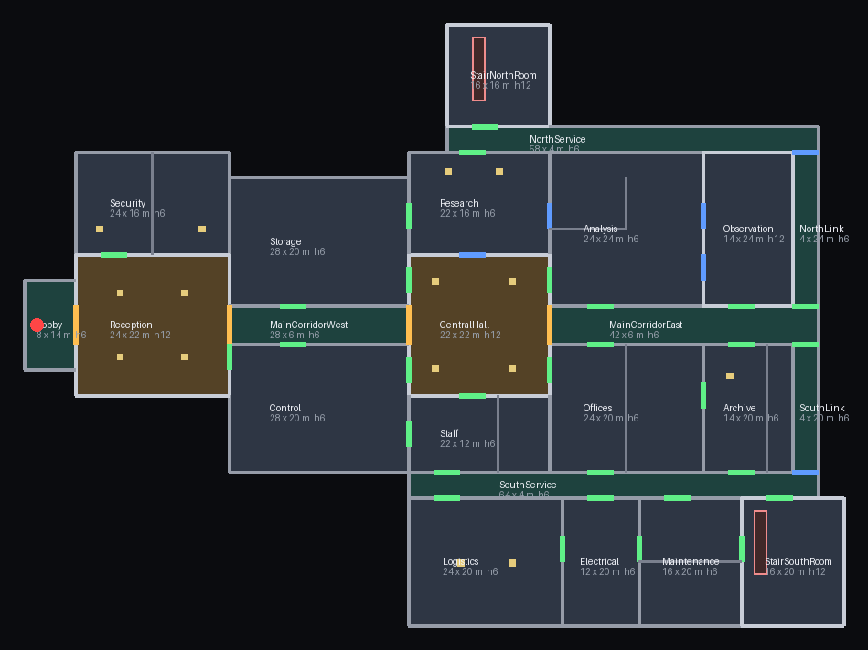

# Etapa 12A — Primeiro andar do laboratório Black Sight

Planta estrutural completa do primeiro andar, montada **somente** com os
módulos aprovados na Etapa 11. Não há móveis, equipamentos, itens, objetivos,
criaturas, iluminação final nem multiplayer: isto é o edifício sobre o qual as
próximas etapas serão construídas.

- versão do projeto: **0.12.0**
- cena: `maps/scenes/laboratory_first_floor.tscn`
- sessão jogável: `match/scenes/laboratory.tscn` (botão **PRIMEIRO ANDAR**)
- gerador da planta: `tools/arch/build_first_floor.py` (tabelas + validação)
- desenho de referência: `tools/arch/render_plan.py` → `docs/images/etapa-12a-planta.png`



---

## 1. Planta

### 1.1 Setores e hierarquia

```
ENTRADA (vestíbulo, oeste)
   │  vão de 6 m
RECEPÇÃO  (pé-direito duplo, 23,6 × 21,6 m)
   ├── SEGURANÇA (norte, ligada só à recepção)
   └── POSTO DE CONTROLE (sul, ligado à recepção e ao corredor)
        │
CORREDOR PRINCIPAL OESTE (5,6 m livres)
        │
GRANDE CRUZAMENTO CENTRAL (21,6 × 21,6 m, teto de 12 m)
        │
CORREDOR PRINCIPAL LESTE (41,6 m de comprimento)
   ├── PESQUISA A / ANÁLISES / OBSERVAÇÃO (norte)
   └── ESCRITÓRIOS / ARQUIVO / FUNCIONÁRIOS (sul)
        │
CORREDORES DE SERVIÇO (norte e sul, 3,6 m livres)
   ├── casas de escada norte e sul
   └── LOGÍSTICA / ELÉTRICA / MANUTENÇÃO (sul)
```

Hierarquia de circulação: eixo principal (recepção → cruzamento → corredor
leste) → corredores de serviço → salas. **Não** existe porta entre todas as
salas: as ligações estão na tabela 1.3.

### 1.2 Ambientes

Células da grade de 2 m; as medidas são **interiores livres** (parede de
0,40 m centrada na linha da célula).

| Ambiente | Nó | Planta (interior) | Área | Pé-direito |
|---|---|---|---|---|
| Entrada (vestíbulo) | `Lobby` | 7,6 × 13,6 m | 103 m² | 6 m |
| Recepção | `Reception` | 23,6 × 21,6 m | 510 m² | 12 m |
| Segurança | `Security` | 23,6 × 15,6 m | 368 m² | 6 m |
| Posto de controle | `Control` | 27,6 × 19,6 m | 541 m² | 6 m |
| Corredor principal (oeste) | `MainCorridorWest` | 27,6 × 5,6 m | 155 m² | 6 m |
| Grande cruzamento central | `CentralHall` | 21,6 × 21,6 m | 467 m² | 12 m |
| Corredor principal (leste) | `MainCorridorEast` | 41,6 × 5,6 m | 233 m² | 6 m |
| Armazenamento | `Storage` | 27,6 × 19,6 m | 541 m² | 6 m |
| Pesquisa A | `Research` | 21,6 × 15,6 m | 337 m² | 6 m |
| Análises | `Analysis` | 23,6 × 23,6 m | 557 m² | 6 m |
| Observação | `Observation` | 13,6 × 23,6 m | 321 m² | 12 m |
| Escritórios | `Offices` | 23,6 × 19,6 m | 463 m² | 6 m |
| Arquivo | `Archive` | 13,6 × 19,6 m | 267 m² | 6 m |
| Corredor de serviço norte | `NorthService` | 57,6 × 3,6 m | 207 m² | 6 m |
| Ligação norte | `NorthLink` | 3,6 × 23,6 m | 85 m² | 6 m |
| Área de funcionários | `Staff` | 21,6 × 11,6 m | 251 m² | 6 m |
| Corredor de serviço sul | `SouthService` | 63,6 × 3,6 m | 229 m² | 6 m |
| Ligação sul | `SouthLink` | 3,6 × 19,6 m | 71 m² | 6 m |
| Apoio logístico | `Logistics` | 23,6 × 19,6 m | 463 m² | 6 m |
| Elétrica | `Electrical` | 11,6 × 19,6 m | 227 m² | 6 m |
| Acesso à manutenção | `Maintenance` | 15,6 × 19,6 m | 306 m² | 6 m |
| Casa da escada sul | `StairSouthRoom` | 15,6 × 19,6 m | 306 m² | 12 m |
| Casa da escada norte | `StairNorthRoom` | 15,6 × 15,6 m | 243 m² | 12 m |

Área construída (interiores): **7.248 m²**. Extensão: **127,6 m** (leste-oeste)
por **93,6 m** (norte-sul). Coordenadas: +X a leste, +Z a sul, y = 0 é o piso
do primeiro andar.

### 1.3 Ligações (vãos)

Os 14 ambientes pedidos mais as circulações estão distribuídos nos setores A,
central, pesquisa, administrativo, funcionários/logística e técnico. Os vãos
são:

| Vão | Tipo |
|---|---|
| Entrada → Recepção | boca de 6 m (sem folha) |
| Recepção → Corredor principal oeste | boca de 6 m |
| Recepção → Segurança | porta 2,4 × 3,0 m |
| Segurança → Recepção | porta 2,4 × 3,0 m |
| Recepção → Controle | porta 2,4 × 3,0 m |
| Corredor oeste → Armazenamento | porta 2,4 × 3,0 m |
| Corredor oeste → Controle | porta 2,4 × 3,0 m |
| Corredor oeste → Cruzamento central | boca de 6 m |
| Cruzamento → Pesquisa A | abertura estrutural 3,6 × 4,2 m |
| Cruzamento → Funcionários | porta 2,4 × 3,0 m |
| Cruzamento → Armazenamento | porta 2,4 × 3,0 m |
| Cruzamento → Controle | porta 2,4 × 3,0 m |
| Cruzamento → Análises | porta 2,4 × 3,0 m |
| Cruzamento → Escritórios | porta 2,4 × 3,0 m |
| Cruzamento → Corredor leste | boca de 6 m |
| Pesquisa A → Análises | abertura estrutural 3,6 × 4,2 m |
| Armazenamento → Pesquisa A | porta 2,4 × 3,0 m |
| Pesquisa A → Corredor norte | porta 2,4 × 3,0 m |
| Análises → Observação | **duas** aberturas de 3,6 × 4,2 m (parede de observação) |
| Corredor leste → Análises | porta 2,4 × 3,0 m |
| Corredor leste → Observação | porta 2,4 × 3,0 m |
| Corredor leste → Escritórios | porta 2,4 × 3,0 m |
| Corredor leste → Arquivo | porta 2,4 × 3,0 m |
| Corredor leste → Ligação norte | porta 2,4 × 3,0 m |
| Corredor leste → Ligação sul | porta 2,4 × 3,0 m |
| Escritórios → Arquivo | porta 2,4 × 3,0 m |
| Escritórios → Corredor sul | porta 2,4 × 3,0 m |
| Arquivo → Corredor sul | porta 2,4 × 3,0 m |
| Controle → Funcionários | porta 2,4 × 3,0 m |
| Funcionários → Corredor sul | porta 2,4 × 3,0 m |
| Corredor norte → Ligação norte | abertura estrutural 3,6 × 4,2 m |
| Corredor norte → Casa da escada norte | porta 2,4 × 3,0 m |
| Corredor sul → Logística | porta 2,4 × 3,0 m |
| Corredor sul → Elétrica | porta 2,4 × 3,0 m |
| Corredor sul → Manutenção | porta 2,4 × 3,0 m |
| Corredor sul → Casa da escada sul | porta 2,4 × 3,0 m |
| Corredor sul → Ligação sul | abertura estrutural 3,6 × 4,2 m |
| Logística → Elétrica | porta 2,4 × 3,0 m |
| Elétrica → Manutenção | porta 2,4 × 3,0 m |
| Manutenção → Casa da escada sul | porta 2,4 × 3,0 m |

Divisórias internas (não fecham o ambiente; dão escala e setorização), todas
com porta de 2,4 × 3,0 m:

- **Escritórios:** duas salas (planta de 23,6 m dividida ao meio, 11,8 × 19,6 m cada).
- **Arquivo:** duas salas de 6,6 × 19,6 m.
- **Análises:** ala norte (sala fria, 11,8 × 7,8 m) e ala de apoio.
- **Funcionários:** apoio de 11,8 × 11,6 m.
- **Segurança:** sala de vídeo de 7,8 × 15,6 m.
- **Manutenção:** depósito de 15,6 × 7,8 m.

### 1.4 Corredores

| Corredor | Comprimento | Largura livre |
|---|---|---|
| Principal oeste | 27,6 m | 5,6 m |
| Grande cruzamento central | 21,6 × 21,6 m | — (alargamento) |
| Principal leste | 41,6 m | 5,6 m |
| Serviço norte | 57,6 m | 3,6 m |
| Serviço sul | 63,6 m | 3,6 m |
| Ligações norte/sul | 23,6 / 19,6 m | 3,6 m |

O eixo principal tem 5,6 m livres (dentro da faixa de 4–6 m pedida); os
corredores de serviço têm 3,6 m (faixa de 3–4 m). O cruzamento central alarga
o eixo para 21,6 m em ambas as direções, com dois metros de teto (12 m) e
quatro pilares de dois níveis.

### 1.5 Escadas

Duas escadas funcionais para o subsolo, em regiões opostas do mapa, com o
módulo aprovado `stairs_straight` **sem alteração**:

| Escada | Casa | Posição | Vão no piso | Hall inferior |
|---|---|---|---|---|
| Norte | `StairNorthRoom` | x 23–25, z −45…−35 | 2 × 6 m | piso em −3,2 m, 2 × 10 m |
| Sul | `StairSouthRoom` | x 67–69, z 29–39 | 2 × 6 m | piso em −3,2 m, 2 × 10 m |

O módulo sobe 3,2 m (meia-altura do pé-direito de 6 m) — foi instalado com o
**topo no piso do primeiro andar** e o pé no hall inferior, o que resolve o
desnível sem alterar a biblioteca aprovada. O hall inferior tem paredes de 6 m
(do fundo até −0,15, sob a laje), piso contínuo e guarda-corpos de 1,9 m nas
três bordas abertas do vão. A escada sul fica a 112 m da norte (nenhuma
proximidade).

O segundo lance (subsolo → andar seguinte) **não** faz parte desta etapa: o
subsolo é a próxima etapa.

### 1.6 Pilares, vigas e acabamento

- 23 instâncias de `pillar` (0,92 × 0,92 m de base) em salas amplas e no
  cruzamento central; 4 delas com dois níveis (12 m). Nenhum pilar bloqueia
  vão, porta ou circulação — validado por script.
- 5 vigas `beam_6m` atravessando o corredor principal (vão livre de 5,6 m),
  nos eixos x = −12, 0, 40, 52 e 64.
- 14 guarda-corpos nos poços das escadas.
- Todas as paredes usam `wall_panel_2m`, `wall_door_4m` e `wall_opening_4m`
  da biblioteca; pisos e tetos usam `floor_tile`, `threshold_2m`,
  `ceiling_tile` e `ceiling_light`; materiais (`wall`, `floor`, `trim`,
  `accent`) são os da Etapa 11. **Nenhum módulo foi criado ou alterado.**

### 1.7 Iluminação (provisória)

A Etapa 12A não faz iluminação final. Para que a planta possa ser percorrida e
revisada, há um `WorldEnvironment` (ambiente e névoa leves) e 33 `OmniLight3D`
espalhadas nos ambientes maiores; as 526 `ceiling_light` da biblioteca já dão
a leitura de luminária. A iluminação definitiva é de uma etapa futura.

---

## 2. Convenções

| Item | Valor |
|---|---|
| Grade | G = 2,0 m |
| Espessura de parede | 0,40 m (centrada na linha) |
| Pé-direito | 6,0 m; grandes volumes 12,0 m |
| Placa de piso/teto | 2 × 2 m, uma por célula (sem sobreposição) |
| Porta | 2,4 × 3,0 m (`wall_door_4m`, módulo de 4 m) |
| Abertura estrutural | 3,6 × 4,2 m (`wall_opening_4m`, módulo de 4 m) |
| Boca de corredor | 6 m de largura e pé-direito total, sem módulo (só soleira) |
| Piso | topo em y = 0; laje de 0,3 m para baixo |
| Teto | face inferior no pé-direito do ambiente |
| Entrada | `Spawn` em (−45, 0,05; 0), olhando para leste |

As placas de piso e teto são instanciadas **por célula**, e não por vão de
ambiente. Isso evita duas placas concêntricas no vão da parede (z-fighting
embaixo de cada porta) e mantém a junta de 5 cm alinhada à grade, como na
cena da Etapa 11.

## 3. Organização da cena

```
LaboratoryFirstFloor (Node3D)
├── STRUCTURE
│   ├── Floors          (1.908 floor_tile + 12 threshold_2m de soleira)
│   ├── Ceilings        (1.372 ceiling_tile + 526 ceiling_light)
│   ├── Walls           (747 wall_panel_2m; inclui 34 painéis "Part_*" de divisória)
│   ├── Doors           (39 wall_door_4m + 6 wall_opening_4m)
│   └── Structural      (23 pillar + 5 beam_6m)
├── CORRIDORS           (7 grupos: Lobby, corredores principal/serviço, ligações…)
├── ROOMS               (16 grupos com marcador Center)
├── STAIRS              (StairNorth e StairSouth: módulo, hall, paredes, guarda-corpos)
├── LIGHTING            (33 OmniLight3D + luz de preenchimento)
├── WorldEnvironment
└── Spawn               (Marker3D)
```

Cada grupo de ambiente tem um `Marker3D` chamado `Center` (usado pela HUD
para informar o ambiente atual e pelos testes para conferir posição).

## 4. Módulos usados

Todos de `maps/modular/` (Etapa 11), sem cópia nem edição: `floor_tile`,
`threshold_2m`, `ceiling_tile`, `ceiling_light`, `wall_panel_2m`,
`wall_door_4m`, `wall_opening_4m`, `pillar`, `beam_6m`, `railing_2m`,
`stairs_straight`.

Os módulos `corridor_*`, `room_*` e `wall_corner_*` **não** foram usados
porque a planta é uma malha contínua de salas e corredores de larguras
diferentes; usar os módulos de corredor fechados criaria paredes duplicadas
onde os corredores se cruzam. As peças de parede/piso/teto são as mesmas que
compõem esses módulos, com as mesmas cotas.

## 5. Decisões

1. **Grade de 2 m em toda a planta.** As salas existentes da biblioteca
   (10 × 10, 12 × 16, 14 × 20, 8 × 8) não têm medidas múltiplas de 2 em todos
   os eixos (10 e 14 são, 12 e 20 também), mas encaixá-las em sequência exigiria
   corredores de larguras incompatíveis e paredes duplicadas. A opção foi
   compor os ambientes com as peças de 2 m, mantendo as cotas de parede, piso e
   teto e o vocabulário visual.
2. **Escadas instaladas de cabeça para baixo.** O `stairs_straight` sobe 3,2 m.
   Para descer ao subsolo sem alterar o módulo, ele foi posicionado com o topo
   no piso do andar e o pé em −3,2 m, dentro de um poço de 2 × 10 m. A
   alternativa — dois lances com patamar — exigiria peças novas e um buraco
   maior no piso.
3. **Bocas de corredor sem módulo.** Os encontros entre eixo principal e
   recepção/cruzamento são vãos livres de 6 m com soleira `threshold_2m`; usar
   `wall_door_4m` ali reduziria a passagem a 2,4 m e quebraria a leitura de
   "corredor largo".
4. **Piso por célula.** Ver seção 2.
5. **Dois vãos de observação.** A parede entre Análises e Observação tem duas
   aberturas de 3,6 m com 1,2 m de parede entre elas, em vez de uma parede de
   vidro (não há vidro na biblioteca). A relação espacial é dada pela diferença
   de pé-direito (6 m × 12 m) e pelos dois vãos.
6. **Sem cantos `wall_corner_*`.** Nas junções em L os painéis já se fecham;
   adicionar o bloco de canto sobreporia faces (z-fighting) sem ganho visível
   de dentro, contrariando a regra de acabamento da 0.11.2.

## 6. Testes

### 6.1 Automatizados

`tools/ci/first_floor_test.tscn` (headless, física real, mesmo controlador do
jogo). Sai com 0 só se **tudo** passar; o log não pode conter `✗`.

1. **Hierarquia e ambientes** — grupos, `Spawn`, 23 ambientes, marcadores de
   centro nas posições calculadas pela tabela, contagem de peças por tipo.
2. **Dimensões e escala** — interiores da tabela, corredor principal 5,6 m,
   serviço 3,6 m, cruzamento 21,6 × 21,6 m, área > 5.500 m², pé-direito ≥ 6 m,
   pelo menos 4 grandes volumes de 12 m.
3. **Piso e teto** — mais de 500 amostras com raio para baixo (y = 0) e para
   cima (face do teto na altura do ambiente); no vão da escada não existe piso
   em 0 e o hall inferior tem piso em −3,2.
4. **Paredes e vãos** — cada lado de cada ambiente é amostrado de 1 em 1 m:
   parede sólida ou vão documentado; nenhum buraco fora da lista. A contagem
   soma as peças de divisória: 30 portas de parede + 9 de divisória = 39;
   689 painéis `Wall_` + 34 `Part_` + 24 painéis dos poços (`ShaftWall*`) =
   747 painéis.
5. **Geometria dos vãos** — canal livre na altura de passagem medido com
   0,7 m de folga de cada bordo (as paredes perpendiculares encostam no vão),
   parede fechando acima (verga) e portas de divisória atravessáveis.
6. **Sem duplicidade** — nenhuma peça na mesma posição, nenhum painel de
   parede sobreposto.
7. **Conectividade real** — o jogador **atravessa os 40 vãos** caminhando
   (não é `has_node`).
8. **Escadas** — desce 3,2 m, chega ao hall inferior, volta a subir e retorna
   ao andar; repetido nas duas escadas.
9. **Rota completa** — 41 pontos conferidos contra as paredes ligam entrada →
   recepção → segurança → controle → corredor → cruzamento → pesquisa →
   análises → observação → escritórios → arquivo → funcionários → logística →
   elétrica → manutenção → escada sul.
10. **Pausa** — `pause_session`/`resume_session` continuam funcionando sobre a
    planta e o jogador não anda pausado.

O `smoke_test.gd` ganhou o grupo `[26] Primeiro andar (Etapa 12A)`: recursos
existem, planta instancia, sessão usa o jogador existente e o botão
**PRIMEIRO ANDAR** está na tela inicial.

A validação da planta também roda em Python, antes de gerar a cena
(`python3 tools/arch/build_first_floor.py --check`): sobreposição de ambientes,
vazios fechados, vãos que não ligam dois ambientes, pilar bloqueando vão,
escada fora do poço, parede sobreposta e instância duplicada.

### 6.2 Manual (obrigatório)

`PRIMEIRO ANDAR` abre a sessão. Percorrer, com o jogo em janela:

**ENTRADA → RECEPÇÃO → SEGURANÇA → CONTROLE → CORREDOR PRINCIPAL →
CRUZAMENTO CENTRAL → PESQUISA → ANÁLISES → OBSERVAÇÃO → ARMAZENAMENTO →
ADMINISTRATIVO (escritórios/arquivo) → LOGÍSTICA → TÉCNICO →
ESCADA SUL → RETORNO**

Conferir: portas passáveis, nenhuma parede atravessável, nenhum buraco no
piso, teto visível em todos os ambientes, escala (o jogador de 1,8 m deve
parecer pequeno), as duas escadas descendo e subindo, corrida com SHIFT, ESC
abrindo e fechando a pausa, sem queda de FPS anormal.

## 7. Limitações

- **Sem iluminação final.** As 33 luzes são provisórias e há névoa leve; nada
  foi calibrado para atmosfera.
- **Sem móveis, equipamentos, objetos interativos, objetivos, criaturas,
  portas funcionais, energia ou eventos de terror.** Os vãos são abertos.
- **Sem subsolo.** O poço das escadas termina num hall de 2 × 10 m com paredes;
  o subsolo é a próxima etapa.
- **Escadas de um lance.** Cada escada vence 3,2 m (meio pé-direito). Para
  chegar a um andar superior será preciso um segundo lance ou uma nova peça.
- **Sem cantos `wall_corner_*`** (ver decisão 6): nas quinas internas a leitura
  vem do encontro dos painéis.
- **Visibilidade:** a leitura de conjunto depende do ambiente; sem
  iluminação final, corredores longos ficam escuros entre luminárias.
- **Custo de cena:** 4.749 nós, 1.908 placas de piso, 1.898 de teto
  (1.372 `ceiling_tile` + 526 `ceiling_light`) e 747 painéis de parede
  (34 deles divisórias internas). É o esperado para a escala pedida, mas é uma cena pesada
  para o renderer GL Compatibility em máquinas modestas; a Etapa 12B deve
  avaliar agrupamento/malha única se necessário.
- **Validação visual** depende de renderização real (CI Windows e revisão
  manual); neste ambiente de trabalho não foi possível abrir o Godot.

## 8. Próximos passos (não iniciados)

1. Revisão manual da planta e ajustes de escala/circulação.
2. Subsolo e segundo lance das escadas.
3. Iluminação final e tratamento acústico/visual dos setores.
4. Móveis, equipamentos e objetos interativos.
5. Objetivos, IA e eventos — somente depois da aprovação da planta.

---

## Anexo A — Reproduzir

```bash
# valida a planta e regrava a cena
python3 tools/arch/build_first_floor.py

# desenha o mapa de referência (Pillow)
python3 tools/arch/render_plan.py docs/images/etapa-12a-planta.png

# testes headless
godot --headless --path . --fixed-fps 60 --audio-driver Dummy res://tools/ci/first_floor_test.tscn
godot --headless --path . --fixed-fps 60 --audio-driver Dummy res://tools/ci/smoke_test.tscn

# capturas (precisa de GPU ou Xvfb)
godot --path . --fixed-fps 60 res://tools/ci/first_floor_visual_check.tscn
```

O CI (`.github/workflows/build.yml`) roda o teste da planta no Linux e no
Windows, gera 14 capturas do andar e publica o ZIP da release com o mesmo
processo da Etapa 11.
